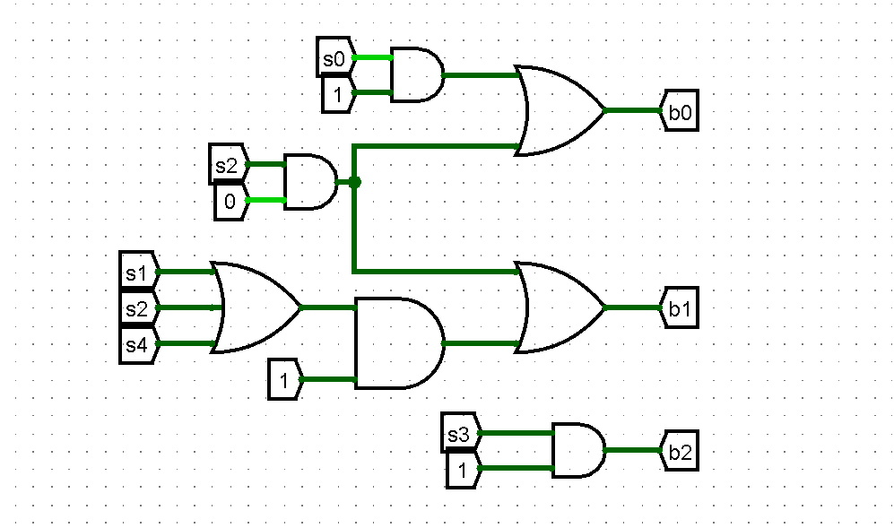
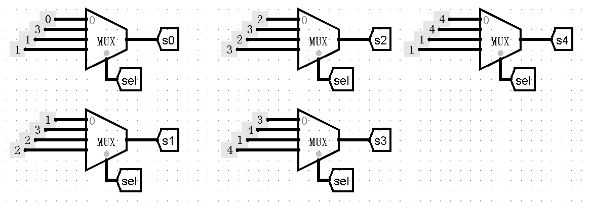
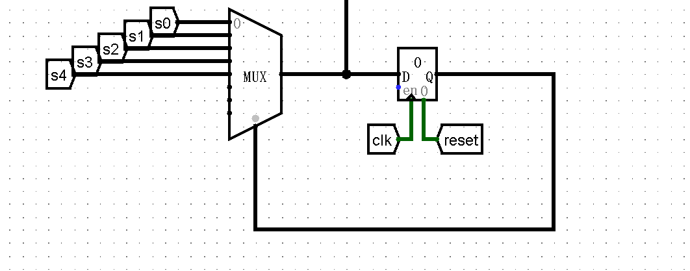
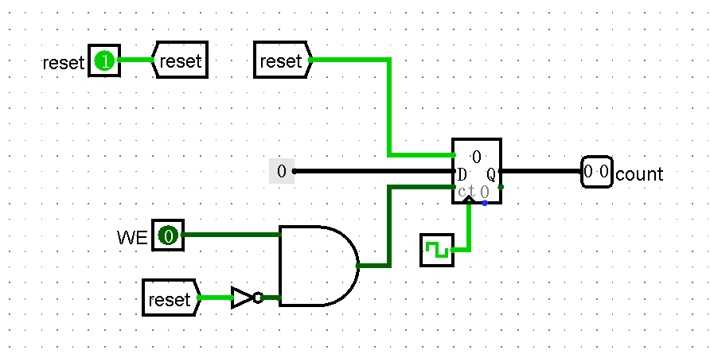

# 状态机设计要点

## 1. 基本结构

状态机由状态存储、下一状态逻辑和输出逻辑组成：

$$
D=F(Q,X)
$$

- Q：当前状态。
- X：当前输入。
- D：下一状态。
- 组合逻辑持续计算，寄存器在有效沿保存结果。

## 2. 状态与转移

设计顺序：

1. 确定需要保存的历史信息。
2. 合并行为等价的历史。
3. 定义状态，写完整转移表。
4. 处理失配、重叠、空闲和复位。
5. 选择编码并实现电路。

状态编码除了作为编号以外，还可以携带实际意义，如 P0-T3 打印机仲裁一题  

可以编码为：

| 历史 | 普通编号 | 带有位含义的编码 |
|---|---|---|
| 空 | 000 | 000 |
| A 连续一次 | 001 | 001 |
| A 连续至少两次 | 010 | 011 |
| B 连续一次 | 011 | 100 |
| B 连续至少两次 | 100 | 110 |

右侧编码中，bit0 表示最近使用者是 A，bit2 表示最近使用者是 B，bit1 表示连续至少两次。  
这样编码，输出最近使用者时可以直接取位。

## 3. 常见实现方式

| 方式 | 核心思路 |
|---|---|
| 按位 | 按位分别处理，推导下一状态各位为 1 的组合逻辑条件，合并各位作为下一个状态 |
| 按表 MUX | 使用组合逻辑，在全部状态情形下用输入信号选择MUX产生下一个状态，按当前实际状态选择真正更新的状态 相当于对照状态转移表，先选输入信号，再选当下状态 |

条件简短、公共项明显时适合按位逻辑；

转移零散、需要直观核对时适合 MUX。可以混用。  

## 4. Moore 与 Mealy

两者的下一状态都由当前状态和输入决定，区别在于对输出的要求：  

$$
\text{Moore：}Y=G(Q)
$$

$$
\text{Mealy：}Y=G(Q,X)
$$

- Moore 输出只依赖已保存的状态；输入单独变化不会改变输出。
- Mealy 输出还可依赖当前输入，可在非时钟沿变化。

- 在同一时钟沿关联更新的寄存器，应在时钟沿生效前提前完成组合逻辑计算，最好不要同周期内使用更新后的寄存器输出值再次作为其他寄存器的输入  
（即靠延迟时钟安排更新顺序）  
组合逻辑运算也需要时间，但其相对于时钟周期可视为瞬时的。  

- Moore 可用更新后的状态进行判定并输出，不一定需要独立输出寄存器；  
若设定输出寄存器，需要核对输出时序是否符合 Moore 规定的周期。

## 5. 复位

- 寄存器同步复位：  
有效沿生效，通常在 D 端通过 MUX 选择复位值，题目涉及使用 `Enable` 时，还要在 `Enable` 接口设置 $write\_ enable（常规使能信号） \lor reset$ 或使用 MUX 置1 ，确保复位信号可以写入。
- 寄存器异步复位：  
无需等待时钟，reset信号直接接到寄存器 `Clear` 接口即可。  
若要求异步复位到非0初值，则需要通过异或方法为寄存器设置初值（实际复位到0，外层输出值为指定值）。  
- Counter 同步复位：
    - `load=1、ct=0` 才是加载；两者均为 1 时是减 1，若不能确保 `ct=0` 也应当在 `ct` 端连 $write\_ enable \land (\neg reset)$ 或使用 MUX 进行置0。
    
