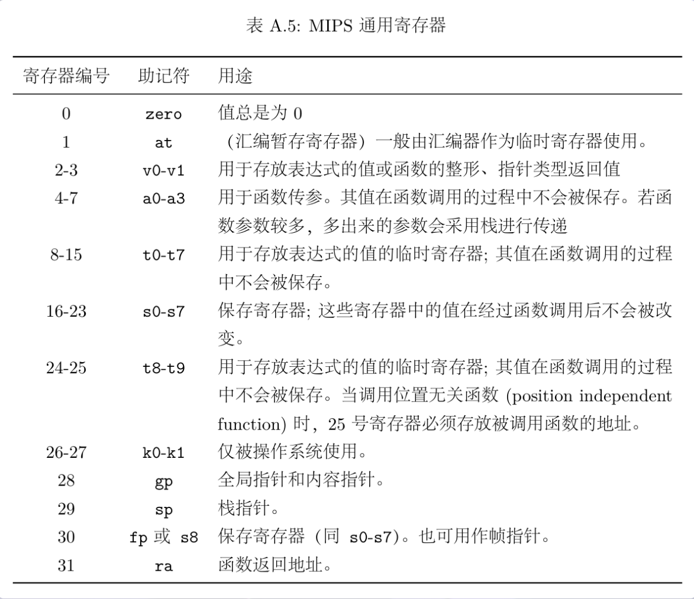
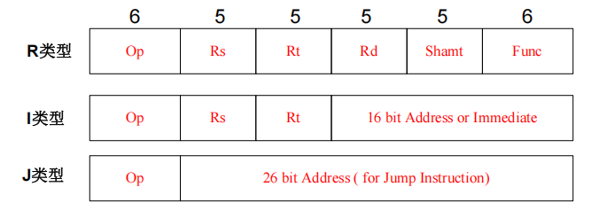

# 1. 32 个通用寄存器

MIPS32 有 32 个通用寄存器，每个宽 32 位。寄存器中的位模式按具体指令解释为整数、地址等数据。



- 普通练习常用 `$t0`～`$t9`、`$s0`～`$s7` 存放变量，并将 `$at` 留给汇编器。
- 函数修改 `$s` 寄存器时，在入口保存旧值，在返回前恢复；调用者需要保留 `$t` 寄存器时，在调用前自行保存。
- 栈通常向低地址增长：分配空间时减小 `$sp`，释放空间时增大 `$sp`。
- `jal` 写入返回地址，`jr $ra` 根据返回地址继续执行。
- `HI`、`LO` 是独立于这 32 个寄存器的特殊寄存器：乘法结果的高、低 32 位分别进入 `HI`、`LO`；除法的余数、商分别进入 `HI`、`LO`。通过 `mfhi`、`mflo` 读取。

# 2. 基本概念

## 2.1. 立即数 `imm`

**立即数**是直接写在指令中的数值，可以用十进制、十六进制等形式书写。

```mips
addiu $t0, $zero, 5      # $t0 = 5
addiu $sp, $sp, -4       # $sp = $sp - 4
ori   $t1, $zero, 0xFF   # $t1 = 255
```

经典 MIPS32 的 I 型机器指令含有 **16 位立即数字段**，其解释取决于指令：

| 指令 | 处理方式 | 直接表示的数值范围 |
|---|---|---|
| `addi`、`addiu`、`slti`、`sltiu` | 符号扩展到 32 位 | −32768～32767 |
| `andi`、`ori`、`xori` | 零扩展到 32 位 | 0～65535 |
| `lui` | 放入结果高 16 位，低 16 位清零 | 字段取值 0～65535 |
| `lb/lbu/lh/lhu/lw`、`sb/sh/sw` 的偏移 | 符号扩展，单位为字节 | −32768～32767 |
| `beq`、`bne` 等条件分支的偏移 | 有符号偏移，单位为 4 字节 | −32768～32767，通常由标签计算 |

- **符号扩展**：高位复制原最高位，保持有符号数的数值。例如 `0xFFFF → 0xFFFFFFFF`，表示 −1。
- **零扩展**：高位补 0。例如 `0xFFFF → 0x0000FFFF`，表示 65535。
- `sltiu` 先将立即数符号扩展，再把两个 32 位操作数按无符号数比较。
- `sll/srl/sra` 的固定移位量使用 R 型指令的 5 位字段，范围为 0～31。

MARS 支持许多扩展写法，较大的立即数可能被汇编器展开成多条指令。需要任意 32 位常数时，常用 `li`：

```mips
li   $t0, 0x12345678     # 伪指令，由汇编器构造 32 位常数
li   $t1, 100000
addu $t2, $t2, $t1      # 用寄存器参与运算
```

## 2.2. 标签 `label`

**标签**是某个地址的名字，定义时在名字后加冒号 `:`，使用时直接写名字。

```mips
.data
number: .word 42

.text
main:
    la $t0, number       # $t0 = number 的地址
    lw $t1, 0($t0)       # $t1 = 42
```

- 数据标签标记对应数据的起始地址，代码标签标记对应指令的地址。
- `la` 取得地址，`lw/lbu` 等指令读取该地址处的数据。
- `beq`、`bne`、`j` 等指令可使用代码标签指定跳转目标，如 `j main`。
- 标签在同一汇编程序中保持唯一，名称通常由字母、数字和下划线组成，并以字母或下划线开头。

## 2.3. 指令结构和类型

一条汇编指令通常由**指令名和操作数**组成，`#` 后面是注释。

```mips
addu $t0, $t1, $t2       # $t0 = $t1 + $t2
```

运算指令通常把目标寄存器写在前面；`sw $t0, 0($s0)` 则将 `$t0` 的数据写入内存。

| 用途 | 常见指令 |
|---|---|
| 运算、位处理 | `addu`、`subu`、`addiu`、`mult`、`div`、`and`、`or`、`sll` |
| 访存 | `lw`、`sw`、`lb`、`lbu`、`sb` |
| 比较、分支 | `slt`、`slti`、`beq`、`bne` |
| 跳转、调用 | `j`、`jal`、`jr` |
| 系统服务 | `syscall` |

经典 MIPS32 的 R、I、J 型机器指令均长 32 位：



| 类型 | 特点 | 例子 |
|---|---|---|
| R 型 | 主要使用寄存器字段，固定移位量放在 `shamt` 中 | `addu`、`sll`、`jr` |
| I 型 | 含 16 位立即数或偏移字段 | `addiu`、`lw`、`beq` |
| J 型 | 含 26 位跳转目标字段 | `j`、`jal` |

图中的 `rs/rt/rd` 存放寄存器编号，`shamt` 是固定移位量，`opcode/funct` 用于识别操作。I 型分支字段表示相对 `PC+4` 的偏移；J 型目标字段与 `PC+4` 的高 4 位、末尾两个 0 拼成目标地址。实操中通常用标签交给汇编器计算。

`li`、`la`、`move`、`blt` 等是**伪指令**，会展开成一条或多条机器指令。MARS 的 Execute → Text Segment 可查看展开后的 Basic 指令和机器码。

## 2.4. 访存方式

### 2.4.1 按位宽数据类型：

MIPS 内存按**字节编址**，地址增加 1 表示移动 1 字节。常见数据大小为：

| 单位 | 大小 | 常见适配数据 | 声明 | 读取 / 写入 |
|---|---|---|---|---|
| 字节 `byte` | 1 字节，8 位 | ASCII 字符、字符数组、0/1 标记 | `.byte` | `lb/lbu`、`sb` |
| 半字 `halfword` | 2 字节，16 位 | 16 位整数、采样数据 | `.half` | `lh/lhu`、`sh` |
| 字 `word` | 4 字节，32 位 | 普通整数、矩阵元素、地址、保存的寄存器值 | `.word` | `lw`、`sw` |

不同宽度能表示的整数范围：

| 位宽 | 有符号整数 | 无符号整数 |
|---|---|---|
| 8 位 | −128～127 | 0～255 |
| 16 位 | −32768～32767 | 0～65535 |
| 32 位 | −2³¹～2³¹−1 | 0～2³²−1 |

选择存储宽度时，综合考虑数值范围、空间占用和访问方式：

- ASCII 字符通常每个用 1 字节。
- 整数数组、矩阵通常每个元素用 4 字节。
- 保存一个完整的 MIPS32 寄存器通常用 4 字节。
- 明确使用 16 位数据时，可采用半字。

内存中的数据读入寄存器时，会形成一个 32 位结果：

- `lb/lh`：符号扩展。
- `lbu/lhu`：零扩展。
- `sb/sh`：分别将寄存器的低 8 位、低 16 位写入内存。
- `lw/sw`：读取或写入完整的 32 位。
- 英文字母、数字等 ASCII 字符每个占 1 字节，常用 `lbu/sb` 处理。其他文字的存储大小取决于编码。


### 2.4.2 寻址方式

常用寻址形式是 **`偏移量(基址寄存器)`**，有效地址等于寄存器中的基址加字节偏移：

```mips
lw    $t0, 8($s0)       # 读取地址 $s0 + 8 开始的 4 字节
sw    $t0, 8($s0)       # 将 $t0 写入同一位置
lbu   $t1, 1($s0)       # 读取地址 $s0 + 1 处的 1 字节
addiu $t2, $s0, 8       # 计算地址 $s0 + 8，结果存入 $t2
```

数组示例：

```mips
.data
array: .word 10, 20, 30

.text
    la $t0, array
    lw $t1, 4($t0)      # array[1] = 20
    sw $t1, 8($t0)      # array[2] = 20
```

MARS 也支持 `lw $t0, number` 等标签访存扩展写法。`la $t2, 8($s0)` 是 MARS 支持的地址计算扩展形式；常用的 `addiu $t2, $s0, 8` 可直接完成这次地址加法。

## 2.5. 程序骨架

本笔记以 **MARS、关闭延迟槽**为运行环境。数据段位置按题目设置；当前课程题目使用 Settings → Memory Configuration → **Compact, Data at Address 0**。

```mips
.data
number: .word 42

.text
main:
    la $t0, number
    lw $a0, 0($t0)
    li $v0, 1           # 输出整数 42
    syscall

    li $v0, 10          # 结束程序
    syscall
```

| 内容 | 作用 |
|---|---|
| `.data` | 后续声明放入数据段 |
| `.text` | 后续指令放入代码段 |
| `main:` | 给程序入口处的指令地址命名 |
| `.globl main` | 将 `main` 声明为全局标签，适用于需要该声明的环境 |
| `syscall` | 根据 `$v0` 中的编号执行 MARS 系统服务 |

以 `.` 开头的 `.data`、`.text`、`.word` 等是**汇编指示符**，由汇编器处理。

- MARS 默认从代码段起始地址运行，将入口代码放在 `.text` 开头即可使用此方式。
- 开启 Initialize Program Counter to global 'main' if defined 后，MARS 优先从全局标签 `main` 开始。
- 课程题目要求省略 `.globl main`，上面的骨架可直接沿用。
- Settings 中的 Permit programs to use extended (pseudo) instructions and formats 控制伪指令支持；本笔记示例使用开启状态。
- 开启延迟槽后，分支或跳转后的第一条指令仍会执行；课程环境与本笔记采用关闭状态。

# 3. 常用指令

## 3.1. 初始化数据

| 写法 | 作用 |
|---|---|
| `.byte 1, 2, 3` | 分配 3 个字节并写入初值 |
| `.half 1, 2` | 分配 2 个半字，共 4 字节，并写入初值 |
| `.word 1, 2, 3` | 分配 3 个字，共 12 字节，并写入初值 |
| `.space 100` | 预留 100 字节 |
| `.ascii "abc"` | 存放 3 个 ASCII 字符 |
| `.asciiz "abc"` | 存放 3 个 ASCII 字符及末尾的 `\0`，共 4 字节 |
| `.align 2` | 将后续数据位置对齐到 4 字节边界；一般 `.align k` 表示按 `2^k` 字节对齐 |

```mips
.data
buffer: .space 128      # 128 字节字符缓冲区
.align 2
array:  .word 0:10      # MARS 重复初始化写法：10 个字均为 0，共 40 字节
msg:    .asciiz "Hello\n"
```

- 数据声明按顺序向高地址分配；`buffer: .space N` 占用从 `buffer` 到 `buffer + N - 1` 的地址。
- 字数组保存 `N` 个整数时通常分配 `4*N` 字节；ASCII 字符数组保存 `N` 个字符时分配 `N` 字节。
- 需要确定初值时，可用 `.word 0:N` 或在程序中循环写入。
- 需要按字符串输出时，给末尾的 `\0` 额外留出 1 字节。

## 3.2. 赋值指令

| 写法 | 结果 |
|---|---|
| `li $t0, 123` | `$t0 = 123` |
| `move $t0, $t1` | 复制 `$t1` 的值到 `$t0` |
| `la $t0, array` | `$t0` = `array` 的地址 |
| `lui $t0, 0x1234` | `$t0 = 0x12340000` (load upper immediate 高16位赋值)|
| `lw $t0, 0($s0)` | 从内存读取一个字到 `$t0` |
| `sw $t0, 0($s0)` | 将 `$t0` 的一个字写入内存 |

`li`、`move`、`la` 是伪指令。`move $t0, $t1` 的效果可用 `addu $t0, $t1, $zero` 实现。

常见初始化：

```mips
move  $t0, $zero         # 清零
la    $s0, array         # 取得数组首地址
addiu $t1, $s0, 4        # 计算下一个字的地址
```

## 3.3. `syscall`

先设置 `$v0` 中的服务编号，再设置参数，执行 `syscall`，最后读取返回值。

| `$v0` | 服务 | 参数 | 返回值 |
|---|---|---|---|
| 1 | 输出有符号整数 | `$a0` = 整数 | — |
| 4 | 输出以 `\0` 结尾的字符串 | `$a0` = 首地址 | — |
| 5 | 读取整数 | — | `$v0` = 整数 |
| 8 | 读取字符串 | `$a0` = 缓冲区地址，`$a1` = 容量 | 数据写入缓冲区 |
| 10 | 结束程序 | — | — |
| 11 | 输出字符 | `$a0` 的低 8 位 = 字符编码 | — |
| 12 | 读取字符 | — | `$v0` = 字符编码 |

读取整数后，及时将结果保存到变量寄存器，再设置下一次服务编号：

```mips
li   $v0, 5
syscall
move $s0, $v0            # 保存输入

move $a0, $s0
li   $v0, 1
syscall

li   $a0, 10            # 换行
li   $v0, 11
syscall
```

允许使用字符常量（如 `'\n'`），形式同 C ，程序中解释为对应 ASCII 码值的立即数。

读取字符串：

```mips
# 配合 .data 中的 buffer: .space 128
la $a0, buffer
li $a1, 128
li $v0, 8
syscall
```

- 容量为 `N` 时，服务 8 最多存入 `N-1` 个字符，并补上 `\0`。输入行较短时，缓冲区通常还包含换行符 `10`。
- 逐字符扫描一行时，常以遇到 `\0` 或换行符作为结束条件。保存长度为 `L` 的 ASCII 内容、换行和 `\0` 时，可预留 `L+2` 字节。
- MARS 系统服务保留表中返回值寄存器以外的寄存器；准备服务时对 `$a0/$a1/$v0` 等寄存器的赋值仍需自行安排。

## 3.4. 运算与位操作

| 写法 | 作用 |
|---|---|
| `addu $t0, $t1, $t2` | `$t0 = $t1 + $t2` |
| `subu $t0, $t1, $t2` | `$t0 = $t1 - $t2` |
| `addiu $t0, $t1, -1` | `$t0 = $t1 - 1` |
| `and $t0, $t1, $t2` | 按位与 |
| `or $t0, $t1, $t2` | 按位或 |
| `xor $t0, $t1, $t2` | 按位异或 |
| `andi $t0, $t1, 0xFF` | 保留 `$t1` 的低 8 位 |
| `ori $t0, $t1, 1` | 将最低位置 1 |
| `xori $t0, $t1, 1` | 翻转最低位 |
| `nor $t0, $t1, $zero` | 按位取反 |
| `sll $t0, $t1, 2` | 左移 2 位，低位补 0，常用于计算字节偏移 `i*4` |
| `srl $t0, $t1, 2` | 逻辑右移 2 位，高位补 0 |
| `sra $t0, $t1, 2` | 算术右移 2 位，高位复制符号位 |

**注意**:  
- `addu/subu/addiu` 并非将数据解释为无符号进行运算，而是**保留运算结果的低 32 位**，常用于计数、地址计算和普通整数计算。它们对有符号数和无符号数产生相同的低 32 位结果，并**忽略溢出异常**；**`addiu` 的立即数仍然符号扩展**。

- `add/addi/sub` 会检查有符号溢出，例如 `0x7FFFFFFF + 1` 触发溢出异常。

乘除法：

```mips
mult $t0, $t1            # 有符号乘法，64 位结果写入 HI:LO
mflo $t2                # 取低 32 位
mfhi $t3                # 取高 32 位

div  $t0, $t1           # 有符号除法；执行前保证除数 $t1 非零
mflo $t2                # 商，向 0 取整
mfhi $t3                # 余数
```

`multu/divu` 按无符号数解释操作数。后续乘除法会更新 `HI/LO`，需要保留的结果应及时取出。`sra` 对负数的舍入方向与有符号除法可能不同，例如 `-3 >> 1 = -2`，而 `-3 / 2 = -1`。

## 3.5. 比较与跳转

| 写法 | 作用 |
|---|---|
| `slt $t0, $t1, $t2` | 有符号比较；`$t1 < $t2` 时结果为 1，否则为 0 |
| `sltu $t0, $t1, $t2` | 无符号比较，其余同上 |
| `slti $t0, $t1, 10` | 有符号比较 `$t1 < 10`，结果写入 `$t0` |
| `beq $t0, $t1, label` | 相等时跳转 |
| `bne $t0, $t1, label` | 不等时跳转 |
| `bltz $t0, label` | 小于 0 时跳转 |
| `blez $t0, label` | 小于等于 0 时跳转 |
| `bgtz $t0, label` | 大于 0 时跳转 |
| `bgez $t0, label` | 大于等于 0 时跳转 |
| `j label` | 无条件跳转 |
| `jal label` | 保存返回地址并跳转 |
| `jr $ra` | 跳转到 `$ra` 保存的地址 |

MARS 可用 `blt/ble/bgt/bge $t0, $t1, label` 简写有符号关系判断；它们是伪指令。使用 `slt` 配合 `beq/bne` 时，比较结果显式保存在寄存器中。

```mips
slt $t2, $t0, $t1       # $t2 = ($t0 < $t1)
bne $t2, $zero, less    # 成立时跳到 less
```

## 3.6. 宏 `macro`

**宏**用于给一段重复代码命名。汇编器在每次使用宏的位置展开宏体，并用实参替换形参，适合封装输入输出、地址计算、压栈等操作。

### 定义与使用

用 `.macro` 开始定义、`.end_macro` 结束定义，形参通常以 `%` 开头。宏定义放在首次使用之前。

```mips
.macro read_int (%dst)
    li   $v0, 5
    syscall
    move %dst, $v0
.end_macro

.macro print_int (%reg)
    move $a0, %reg
    li   $v0, 1
    syscall
.end_macro

.text
main:
    read_int ($s0)      # 读取整数，保存到 $s0
    print_int ($s0)     # 输出 $s0

    li $v0, 10
    syscall
```

- 宏定义实现的就是智能的文本替换展开，对参数没有要求，实参可以是立即数、寄存器或标签，实际应按宏体中对应指令的操作数要求传入。
- 宏体中的指令直接影响当前寄存器：`read_int` 修改 `$v0` 和目标寄存器，`print_int` 修改 `$a0/$v0`。
- 每次使用都会展开一份代码，执行指令数按展开后的机器指令计算。
- MARS 为宏体内部定义的标签添加唯一后缀，支持同一个宏多次展开。
- MARS 的每个宏实参对应一个词法单元；传递 `4($t0)` 这样的地址时，可将偏移量和基址分别设为参数。

### 示例：矩阵寻址

按行连续存放、每个元素占 4 字节的矩阵：

`元素地址 = base + 4*(row*cols + col)`

```mips
.macro matrix_addr (%dst, %base, %row, %col, %cols)
    mult %row, %cols
    mflo %dst
    addu %dst, %dst, %col
    sll  %dst, %dst, 2
    addu %dst, %dst, %base
.end_macro

# $s0 = 矩阵首地址，$s1 = 列数
# $t0 = 行下标，$t1 = 列下标
matrix_addr ($t2, $s0, $t0, $t1, $s1)
lw $t3, 0($t2)         # 读取对应元素
```

该宏修改 `%dst` 和 `HI/LO`。使用时，为目标地址和输入参数选择不同的寄存器。

### 宏与函数

| 对比 | 宏 | 函数 |
|---|---|---|
| 使用方式 | 汇编时在使用位置展开代码 | 运行时通过 `jal` 调用、`jr $ra` 返回 |
| 代码存放 | 每个使用位置有一份展开代码 | 多次调用共用同一段函数体 |
| 参数处理 | 汇编时替换形参 | 通过寄存器或栈传参 |
| 适合用途 | 简短、重复的操作模板 | 较大逻辑、递归等操作 |

### 常量与公共宏文件

`.eqv` 为常量或文本替换命名：

```mips
.eqv MAX_N 20

li $t0, MAX_N          # 等价于 li $t0, 20
```

`.include` 将指定文件的内容插入当前位置，可用于引入公共宏：

```mips
.include "macros.asm"
```

# 4. 常用操作

以下片段中的变量已放入对应寄存器；组合代码时为各段标签使用唯一名称。

## 4.1. `if` 判断

实现 `if (a < b) x = 1; else x = 0;`，其中 `$t0=a`、`$t1=b`、`$t3=x`：

```mips
    slt  $t2, $t0, $t1
    beq  $t2, $zero, if_else
    li   $t3, 1
    j    if_end
if_else:
    li   $t3, 0
if_end:
```

多个条件组合时：`A && B` 在任一条件失败后跳到失败分支；`A || B` 在任一条件成功后跳到成功分支。

## 4.2. `while` 循环

结构为**检查条件 → 循环体 → 回到条件检查**。以下实现 `while (i < n) i++;`，其中 `$t0=i`、`$s0=n`：

```mips
while_check:
    slt   $t1, $t0, $s0
    beq   $t1, $zero, while_end
    # 在此放置循环体
    addiu $t0, $t0, 1
    j     while_check
while_end:
```

## 4.3. `for` 循环

结构为**初始化 → 检查条件 → 循环体 → 更新变量 → 回到条件检查**。以下实现 `for (i=0; i<n; i++)`：

```mips
    move  $t0, $zero
for_check:
    slt   $t1, $t0, $s0
    beq   $t1, $zero, for_end
    # 在此放置循环体
for_update:
    addiu $t0, $t0, 1
    j     for_check
for_end:
```

- `break` 跳到 `for_end`；`continue` 跳到 `for_update`。
- 多层循环中，每次进入内层循环前，重新初始化内层变量；每次计算新的累加结果前，将累加器清零。

## 4.4. 数组

### 一维数组

下标从 0 开始。元素宽度为 `size` 字节时：

`array[i] 的地址 = base + i*size`

字数组每个元素占 4 字节，字符数组每个 ASCII 字符占 1 字节。

```mips
# $s0 = 字数组首地址，$t0 = i
sll  $t1, $t0, 2
addu $t2, $s0, $t1
lw   $t3, 0($t2)        # 读取 array[i]
sw   $t3, 0($t2)        # 写入 array[i]

# $s1 = 字符数组首地址，$t0 = i
addu $t2, $s1, $t0
lbu  $t3, 0($t2)        # 读取字符
sb   $t3, 0($t2)        # 写入字符
```

按顺序遍历时，可直接移动指针：字数组每次加 4，字符数组每次加 1。

### 二维数组

按行连续存放、有 `cols` 列、每个元素占 4 字节的矩阵：

`A[i][j] 的地址 = base + 4*(i*cols+j)`

```mips
# $s0 = base，$s1 = cols，$t0 = i，$t1 = j
mult $t0, $s1
mflo $t2
addu $t2, $t2, $t1
sll  $t2, $t2, 2
addu $t2, $s0, $t2
lw   $t3, 0($t2)        # A[i][j]
```

采用固定行宽保存矩阵时，公式中的 `cols` 使用实际存储行宽。例如每行固定预留 8 个字时，行跨度为 32 字节。

## 4.5. 栈

栈通过**后进先出**组织数据。常见用途包括保存寄存器、维护函数调用现场，以及模拟题目中的栈。

### 用 `$sp` 保存数据

MARS 初始化运行环境时会设置 `$sp`。保存一个 32 位寄存器常用 4 字节：

```mips
# 压栈
addiu $sp, $sp, -4
sw    $t0, 0($sp)

# 出栈，取回到 $t0
lw    $t0, 0($sp)
addiu $sp, $sp, 4
```

多个寄存器可一次分配空间，再用固定偏移保存。按字存取时，栈地址保持 4 字节对齐；课程外采用具体 ABI 时，按其规则设置栈帧对齐。

### 用数组模拟题目中的栈

可用 `.space` 分配字节数组，并让 `top` 表示当前元素个数：

- 空栈：`top == 0`。
- 栈顶字符地址：`base + top - 1`，读取前先检查栈非空。
- 压入字符：存到 `base + top`，然后 `top++`。
- 弹出字符：`top--`。

```mips
# $s0 = base，$t0 = top，$t1 = 待压入字符
addu  $t2, $s0, $t0
sb    $t1, 0($t2)
addiu $t0, $t0, 1
```

数组位置由声明向高地址分配，`top` 的变化方向由实现约定决定。若将栈中内容作为字符串输出，可在 `base + top` 写入 `\0`，并提前为它留出容量。

## 4.6. 函数调用与递归

常用约定：参数放在 `$a0`～`$a3`，返回值放在 `$v0`～`$v1`，用 `jal` 调用、`jr $ra` 返回。

调用中需要保留的数据按以下规则安排：

- 调用者保存调用后仍需使用的 `$t`、`$a` 等寄存器值。
- 被调用者保存、恢复自己修改的 `$s` 寄存器。
- 函数继续调用其他函数时，在调用前保存自己的 `$ra`，返回前恢复。
- 每层递归使用独立栈帧，保存该层的返回地址和局部状态。

```mips
# 函数骨架：$a0 传入本层状态，$s0 在本函数中使用
# 需要继续调用时，将下面的 next_function 换成具体函数名
func:
    addiu $sp, $sp, -8
    sw    $ra, 4($sp)
    sw    $s0, 0($sp)
    move  $s0, $a0

    # 处理本层状态，按需设置下一次调用的参数
    # jal next_function
    # 返回后，继续使用本层 $s0 中的状态
    # 按需将函数返回值放入 $v0

    lw    $s0, 0($sp)
    lw    $ra, 4($sp)
    addiu $sp, $sp, 8
    jr    $ra
```

全排列等回溯题通常按**判断终点 → 枚举选择 → 设置标记 → 递归 → 撤销标记**组织代码。递归返回后仍需使用的层数、枚举变量和地址，应放入本层已保存的寄存器或栈帧中。

关于返回地址：本笔记关闭 MARS 延迟槽时，`jal` 返回到源码中紧随调用的下一条指令；经典带延迟槽的 MIPS 中，`jal` 保存 `PC+8`，用于跳过已执行的延迟槽指令。

# 5. 实操查阅

- **调试地址**：观察基址、下标和最终地址；字数组先算元素下标，再乘 4。
- **调试循环**：观察初始化、退出条件和更新位置；为内层变量、累加器设置正确的重置位置。
- **调试递归**：检查每层保存的数据、恢复顺序，以及 `$sp` 的分配和释放是否成对。
- **检查输出**：按题目输出空格、换行和结束符；课程评测只输出要求的结果。
- **核对运行环境**：按题目设置内存布局、延迟槽和伪指令选项，再用样例及最小、最大规模测试。

参考：[MARS 系统服务](https://dpetersanderson.github.io/Help/SyscallHelp.html)、[MARS 设置](https://dpetersanderson.github.io/Help/MarsHelpSettings.html)、[MIPS32 指令手册](https://pages.hmc.edu/harris/class/e155/11/MIPS32InstructionSet.pdf)。
